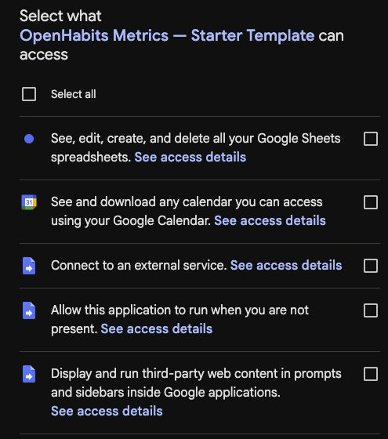

# OpenHabits Metrics Setup

This guide connects your Sheet and shortcuts, then lets you try recording values and timing a session. Afterward, you can customize your metrics or [set up iOS app protection](guides/ios-lockouts.md).

**Use an AI to help you through setup.** You are encouraged to give an AI of your choice [a link to this repository](https://github.com/CopperPanMan/OpenHabits-Metrics) and ask it to guide you through setup and usage, explain settings, or answer questions as you go. This works best with capable paid models. Tell it what you want to track or protect so it can help you choose the relevant steps.

You need a Google account and an iPhone with Apple Shortcuts and **Scriptable**. The provided timer uses Scriptable, as do iOS app protection and Calendar Alarms integration. Notion and third-party blocking apps are optional.

## 1. Copy the starter Sheet

**[Copy the starter Google Sheet](https://docs.google.com/spreadsheets/d/1SRYOKMYJ4OeGeBFTM5nKGgrCIm3cNWomRiujVyGoV_o/copy)** to create your own copy. It includes the bound Apps Script and these metrics, matching the preloaded templates:

| Metric | What the demo records |
| --- | --- |
| Glasses of Water (`glass_of_water`) | Adds one glass each time you run the logger |
| Last Drank (`last_drank`) | Records the latest time you ran that same logger |
| Time Working (`time_working`) | Adds elapsed time when you stop the timer |

The **Tracking Data** tab holds your history. **OpenHabits → Open OpenHabits** opens its settings panel.

> [!NOTE]
> **Google will ask for authorization when you first click "open OpenHabits" or when you complete the deployment steps below, whichever you do first.** If you see this authorization prompt, read more at [Authorize your copy](#authorize-your-copy) below.

The starter's tracking day begins at **5 a.m.**: a recording at 1 a.m. belongs to the previous tracking day. You can change this later under **Metrics → Metric Settings → Late Extension Hours**.

<details>
<summary>Install the Sheet manually (alternative)</summary>

1. Create a Google Sheet. Open **Extensions → Apps Script**.
2. Create script files and paste [Main.gs](../Main.gs), [Config.gs](../Config.gs), [Lockouts.gs](../Lockouts.gs), and [SetupV2.gs](../SetupV2.gs).
3. Create HTML files named **SetupV2Launcher** and **SetupV2Styles**, using [SetupV2Launcher.html](../SetupV2Launcher.html) and [SetupV2Styles.html](../SetupV2Styles.html). Apps Script adds the `.html` extension.
4. In **Project Settings**, enable **Show “appsscript.json” manifest file in editor**. Return to **Editor**, open **appsscript.json**, and replace its contents with [appsscript.json](../appsscript.json). This explicitly sets the permissions, including read-only Calendar access. Set the script timezone to match your Sheet.
5. Save, run **openHabitsShowLauncher** once, follow [Authorize your copy](#authorize-your-copy), and reload the Sheet.
6. In the OpenHabits panel, choose [starter-config.json](../Examples/starter-config.json) under **Or choose a configuration backup**, then **Save and Apply**.

The JSON configures the Sheet with the same starter metrics as the shared template.

</details>

## 2. Deploy your web app

1. In the Sheet, open **File → Settings** and set its timezone to your intended home timezone. Then open **Extensions → Apps Script → Project Settings** and set the same timezone there.
2. Under **Script properties**, add **OPENHABITS_SECRET** with a long random value. Keep it for the shortcut setup below.
3. Choose **Deploy → New deployment → Web app**. Set **Execute as** to **Me** and **Who has access** to **Anyone**. Before choosing **Authorize access**, read the note below, then authorize and deploy.
4. Copy the **deployment ID**, the portion between `/s/` and `/exec` in the URL:

   `https://script.google.com/macros/s/DEPLOYMENT_ID/exec`

Your secret lets your shortcuts call this deployment. A script bound to your Sheet does not need a separate spreadsheet ID property. [Google's deployment instructions](https://developers.google.com/apps-script/guides/web) explain the account-specific deployment options.

### Authorize your copy

> [!NOTE]
> **Google will ask you to authorize OpenHabits before you can use it.** You’re authorizing the Apps Script attached to your copy of the Sheet. Its source code is available in this repository - feel free to ask an AI of your choice to help you review it before continuing. Authorizing the script does **not** share your Sheet with the template’s maintainer—it is *your* personal copy.
>
> You may also see **“Google hasn’t verified this app.”** Google verifies individual app identities, and each copy of OpenHabits has its own identity. Verifying the original template would not automatically verify your copy, so this warning is expected with this setup.
>
> Some of Google’s permission categories grant broader access than OpenHabits currently uses. The toggle below explains each permission and what it enables.

<details>
<summary>What each permission allows, and why OpenHabits requests it</summary>

   
   
- **Google Sheets — see, edit, create, and delete spreadsheets.** OpenHabits reads and writes your metric history, configuration, and tracking rows. Google’s grant covers all your Sheets; it is not restricted to this copy. The script uses the bound Sheet by default and also supports a spreadsheet explicitly configured by ID.
- **Google Calendar — see and download calendars you can access.** The optional preset-calendar feature reads event titles from the calendar you configure to choose a day’s preset. The grant covers calendars you can access, not just that configured calendar. The current manifest requests **read-only** access: it does not grant permission to create, edit, share, or delete calendars or events. Older copies may still request the broader Calendar permission; see the update instructions below.
- **Connect to an external service.** The optional Notion integration sends requests to Notion’s API when configured and used. This Google permission permits external requests generally; it is not limited to Notion. The starter has Notion disabled and contains no Notion token.
- **Run when you are not present.** OpenHabits can install a scheduled trigger to recompute streaks, so that work can happen while the Sheet is closed. Authorizing this permission does not install the trigger; the starter includes no installed triggers.
- **Display and run third-party web content in prompts and sidebars.** This lets OpenHabits display its HTML settings panel inside Google Sheets. It does not install a browser extension.

These permissions are listed explicitly in [appsscript.json](../appsscript.json). Calendar and Notion features are optional, but their permissions are still requested by this combined script. Declining individual permissions can cause features or setup to fail; OpenHabits does not yet guide you through partial authorization.

You can inspect the code under **Extensions → Apps Script** and remove the script’s access later from [your Google Account’s third-party connections](https://myaccount.google.com/connections). Removing access prevents authorized features from working until you authorize again. See Google’s explanations of [Apps Script scopes](https://developers.google.com/apps-script/concepts/scopes) and [unverified apps](https://support.google.com/googleapi/answer/7454865).

</details>

## 3. Install the iPhone shortcuts

Each shortcut contains **Comment blocks with instructions**. Open it in the Shortcuts editor and read those blocks for setup, customization, and optional integrations.

**Install these three shortcuts:**

| Shortcut & install link | What it does and why you need it |
| --- | --- |
| **[Insights](https://www.icloud.com/shortcuts/0934f080c7084c0d8ad883d202652216)** | Connects your loggers to the Sheet and displays feedback. Used by both templates. |
| **[Metric(s) Logger Template](https://www.icloud.com/shortcuts/bca83c9f1d3340f38094778cfca093dc)** | Records one or more metrics. Comes ready for the water demo; duplicate it later for your own loggers. |
| **[Toggle Timer Template](https://www.icloud.com/shortcuts/84c489c9e49b4721a8cf4346517aa654)** | Starts/stops a timer and records elapsed time. Used for the timer demo; keep it for anything you want to time. |

**Also using iOS app protection?** Install all three below. For Calendar Alarms integration alone, install **Update Lockout Cache**; you do not need Locked or Allowed.

| Shortcut & install link | What it does and why you need it |
| --- | --- |
| **[Locked](https://www.icloud.com/shortcuts/d156f901cf734dbfb0ccb5689b564fdc)** | Checks your rules when a protected app opens and redirects you when blocked. NOTE: *You will need to set an automation to run this whenever a protected app is opened (you choose the apps). Further instructions can be found inside the shortcut.*|
| **[Allowed](https://www.icloud.com/shortcuts/6f039200e4e146789659301e609f085a)** | Handles allowed access and lets you request a temporary unlock. *Further instructions can be found inside the shortcut.*|
| **[Update Lockout Cache](https://www.icloud.com/shortcuts/89f524dec58a4701af1e1d381a0d51fd)** | Refreshes the local metric/rule data used by iOS protection and OpenHabits reminders/task checks in Calendar Alarms. |

**For screen-time tracking**, finish the basic demos first, then follow [screen-time setup](guides/ios-lockouts.md#add-a-screen-time-allowance). It covers the timer helpers, app automations, and verification.

## 4. Connect Insights

### Prepare Scriptable

Do this for the timer demo even if you are not using app protection or Calendar Alarms.

1. Install **Scriptable**, open **Settings → File Bookmarks**, and create a bookmark named exactly **Shortcuts** pointing to **iCloud Drive/Shortcuts**.
2. Keep **Toggle Timer Template** under its original name until Insights setup is finished. The current Insights installer detects that template or **Update Lockout Cache** and installs the helper scripts.

### Enter your connection settings

Manually run **Insights**. Enter the same **Secret** and **Web App Id** from step 2, then choose **I'm Finished**. Both templates use these connection settings.

Open Scriptable and confirm **OpenHabits Runtime** is present before trying the timer. Its **Shortcuts** bookmark is needed when the timer confirms a recording.

<details>
<summary>If OpenHabits Runtime is missing after setup</summary>

An older Insights shortcut may only install scripts when app protection is present. In Scriptable, create scripts named **OpenHabits Runtime** and **lockouts**, pasting the full contents of [OpenHabits Runtime.js](../OpenHabits%20Runtime.js) and [lockouts.js](../lockouts.js) respectively. Keep the **Shortcuts** bookmark from above. These scripts provide the current timer and integration helpers; installing them does not change the actions inside an older shortcut.

</details>

<details>
<summary>If you installed Update Lockout Cache: refresh your phone</summary>

Confirm **lockouts** is also present in Scriptable. If it is missing, rerun Insights setup or use the manual installation above. Run **Update Lockout Cache** without input once, with the phone unlocked, and approve its permissions.

Follow [app protection](guides/ios-lockouts.md) to activate protection, or [Calendar Alarms integration](guides/calendar-alarms.md) to use reminders and task checks. Installing these shortcuts alone does not protect apps.

</details>

## 5. Try the templates

### Record two metrics together

Run **Metric(s) Logger Template**, approve its permissions, and check today's cells. **Glasses of Water** should be `1`, and **Last Drank** should contain the current time. Run it again: the count becomes `2` and Last Drank updates.

The preloaded Text action is:

```json
[["glass_of_water",1],["last_drank"]]
```

The explicit `1` adds one glass. Timestamp metrics can record the current time without a supplied value.

### Time a session

Run **Toggle Timer Template** to start. Wait a minute, then run it again to stop. The elapsed time should appear in **Time Working**. A second completed session adds to the same daily total. Starting alone does not write a duration.

The timer comes configured with `[["time_working"]]`. Its comment blocks explain optional calendar/Focus actions; you can leave those out of the demo.

If either demo fails, use [Troubleshooting](guides/maintenance.md#troubleshooting) before continuing.

## 6. Make it yours

### Create your first personal habit

Try a one-tap habit called **Flossed**:

1. Open the Sheet's settings panel and use **Copy Current Configuration → Open Config Editor → Load Copied Configuration**.
2. Under **Add a metric**, choose **Done / not done**, click **Add metric**, and change its Display Name to **Flossed**. Its generated Metric ID becomes `flossed`; keep that ID.
3. Choose **Finish and Copy for OpenHabits**, return to the Sheet panel, paste the configuration, and choose **Save and Apply**. This creates its tracking row; ordinary configuration changes do not need a new deployment.
4. Return to the editor, open Flossed, and choose **Set up logging for this metric**. The generator selects it and produces `[["flossed",1]]`. Choose **Copy metric text**.
5. Duplicate **Metric(s) Logger Template**, rename the copy **Log Flossed**, and replace its entire **Text** action with the copied text. Confirm its **Run Shortcut** action calls **Insights**.
6. Run **Log Flossed**, approve any permissions, and check that its Sheet cell is `1`. Add it to your Home Screen or a Shortcuts widget so it is easy to run after flossing. This recipe keeps the first recording, so a second tap that day leaves it at `1`.

The same flow works for other metrics. See [logger input examples](guides/metrics.md) for values you enter each time, [timers](guides/timers.md) for durations, or [quick launchers](guides/launchers.md) for QR codes, NFC, and Siri.

If you use iPhone app protection or Calendar Alarms reminders/task checks, run **Update Lockout Cache** without input on each iPhone after applying configuration changes.

<details>
<summary>Organize a larger configuration and find advanced settings</summary>

Metric and block cards start collapsed when you load a configuration. Click a card's header to edit it, or use **Expand All / Collapse All** in either tab. Drag the grab handle on a metric or block header to rearrange it, or use the up/down arrows. Each block's numbered rule order determines which applicable rule supplies the message. New and duplicated items open automatically. **Create folder** adds a folder tile in either list; drag cards onto its header to move them inside, and click the header to open or close it. Moving a folder or assigning its contents keeps block priority. Search metrics by name or ID, and blocks by name, preset, or referenced metric; search also finds folder names and reveals matches inside closed folders. If finishing reveals validation errors, the editor opens the affected folder and field; select another error to jump to its settings.

Settings shared by metrics live under **Metrics → Metric Settings**, closed by default. Block display, preset-calendar overrides, and timezone defaults live under **Blocks → Advanced Block Settings**. Most setups can leave these defaults alone. Choose the screen-time metric on each duration block; there is no additional global screen-time ID to configure.

The panel shows a notice when a setup issue needs attention. Full checks and the last-saved time are under **Troubleshooting and preferences → System diagnostics**; when everything is ready, you can go straight to applying your editor changes.

</details>

## 7. Set up app protection

Use your metrics to make access depend on what you have done: require a day plan before opening social apps, limit accumulated app time, or protect a window after an event.

[**Set up iOS app protection →**](guides/ios-lockouts.md) takes you through a complete first rule, app automation, verification, temporary unlocks, and everyday use. You can choose different rules and day presets afterward.

For websites on your computer, use [Chrome website protection](guides/chrome.md). For reminders and task-based alarms, use [Calendar Alarms integration](guides/calendar-alarms.md). [More features](features.md) covers points, streaks, insights, Notion, and other ways to log.
